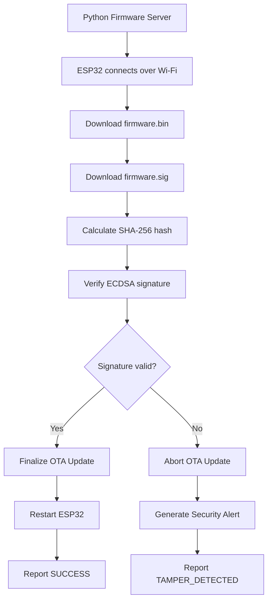

# 🔐 ESP32 Secure OTA Firmware Update System

<p align="center">
  
  
  
  
</p>

<p align="center">
  A secure Over-the-Air (OTA) firmware update system for ESP32 devices, implementing ECDSA digital signature verification and SHA-256 integrity checking to detect and reject unauthorized firmware modifications.
</p>

---

## 📌 Overview

Firmware updates are an essential part of maintaining IoT devices. However, updating connected devices wirelessly introduces security risks, particularly when firmware can be intercepted, modified or replaced by unauthorized parties.

**ESP32 Secure OTA** addresses this problem by implementing a cryptographic verification mechanism for wireless firmware updates.

The system consists of an ESP32 microcontroller and a Python-based firmware server. Before accepting an update, the ESP32 downloads the firmware and its associated digital signature, calculates its SHA-256 hash and verifies the signature using an embedded ECDSA public key.

Only firmware that passes the cryptographic verification process is accepted for installation.

If the firmware has been modified or its signature is invalid, the update is rejected and a security alert is sent to the server.

## ✨ Features

- 📡 **Wireless OTA Updates:** Update ESP32 firmware over Wi-Fi without requiring a USB connection for every update.
- 🔐 **ECDSA Authentication:** Verify firmware authenticity using elliptic-curve digital signatures.
- 🔎 **SHA-256 Integrity Checking:** Detect unauthorized modifications to firmware binaries.
- 🛡️ **Tampering Detection:** Reject firmware with invalid digital signatures.
- 🖥️ **Python Firmware Server:** Host firmware binaries and digital signatures on a local server.
- 📊 **Update Status Reporting:** Send update results and security alerts from the ESP32 to the server.
- 🔑 **Public/Private Key Cryptography:** Use a private key for signing and a public key for verification.

---

## 🏗️ System Architecture

The project is divided into two main components:

### 1. Python Firmware Server

The server runs on a computer connected to the same network as the ESP32.

Its responsibilities include:
- Hosting firmware binaries.
- Providing the corresponding digital signatures.
- Receiving update status reports from the ESP32.
- Generating and distributing signed firmware packages.

### 2. ESP32 IoT Device

The ESP32 acts as the receiving IoT device.

Its responsibilities include:
- Connecting to the Wi-Fi network.
- Downloading firmware from the server.
- Downloading the associated digital signature.
- Calculating the firmware's SHA-256 hash.
- Verifying the ECDSA digital signature.
- Accepting or rejecting the firmware update.
- Reporting the verification result to the server.

### 🔄 Update Workflow



---

## 🔐 Security Implementation

### ECDSA Digital Signature Verification

The project uses the **Elliptic Curve Digital Signature Algorithm (ECDSA)** with the SECP256R1 curve.

Two cryptographic keys are generated:

| Key | Purpose |
|---|---|
| Private Key | Used to digitally sign firmware binaries. |
| Public Key | Embedded in the ESP32 to verify firmware signatures. |

The private key remains on the trusted signing side, while the ESP32 uses the public key to authenticate downloaded firmware.

### SHA-256 Integrity Verification

SHA-256 is used to calculate a cryptographic hash of the firmware binary.

The signature verification process ensures that the downloaded firmware corresponds to the firmware signed by the private key.

Any unauthorized modification to the signed binary should cause the verification process to fail.

### Firmware Tampering Detection

If signature verification fails:

- The OTA update is aborted.
- The ESP32 refuses to finalize the update.
- A security alert is displayed in the Serial Monitor.
- The server receives a `TAMPER_DETECTED` notification.

This prevents firmware with an invalid signature from being accepted through the implemented OTA process.

---

## 🧰 Hardware & Software Requirements

### Hardware

| Component | Description |
|---|---|
| ESP32 DevKit | Main embedded IoT controller |
| USB Cable | Programming and serial communication |
| Wi-Fi Network | Wireless communication between ESP32 and server |
| Computer | Hosts the Python firmware server |

### Software & Technologies

| Technology | Purpose |
|---|---|
| Arduino IDE | ESP32 firmware development |
| C/C++ | Embedded programming |
| Python 3 | Firmware server and cryptographic scripts |
| Python Cryptography | ECDSA key generation and signing |
| Mbed TLS | Cryptographic verification on ESP32 |
| HTTP | Communication between ESP32 and server |
| SHA-256 | Firmware integrity verification |
| ECDSA | Firmware digital signatures |

---

## 📂 Project Structure

```text
ESP32-Secure-OTA/
│
├── sketch_oct28a.ino       # ESP32 firmware
│
├── server.py               # Python OTA server
│
├── generate_keys.py        # ECDSA key generation
│
├── sign.py                 # Firmware signing script
│
└── README.md               # Project documentation
```

Generated files:

```text
firmware.bin                # Compiled firmware binary
firmware.sig                # Digital signature
private_key.pem             # Private signing key
public_key.pem              # Public verification key
```

**Security Note:** Never upload your private signing key or Wi-Fi credentials to a public repository. Keep them outside version control.

---

## ⚙️ Installation & Setup

### 1. Requirements

Install the following software:

- [Arduino IDE](https://www.arduino.cc/en/software)
- [Python 3](https://www.python.org/downloads/)
- ESP32 board package for Arduino IDE.

Install the required Python dependency:

```bash
pip install cryptography
```

### 2. Generate Cryptographic Keys

Run the key generation script:

```bash
python generate_keys.py
```

This generates the ECDSA private and public keys.

- `private_key.pem`: Used to sign firmware.
- `public_key.pem`: Used to verify firmware signatures.

Keep the private key secure.

### 3. Configure the ESP32

Open the ESP32 sketch in Arduino IDE.

Configure:
- Wi-Fi SSID and password.
- Firmware server IP address.
- Firmware download URL.
- Signature download URL.
- Public key used for verification.

Make sure the ESP32 and computer can communicate over the same network.

### 4. Compile the Firmware

Compile the ESP32 sketch using Arduino IDE.

Export the compiled binary:

**Sketch → Export Compiled Binary**

Rename the appropriate generated binary:

```text
firmware.bin
```

### 5. Sign the Firmware

Place the firmware binary and private key in the appropriate working directory.

Run:

```bash
python sign.py
```

This generates:

```text
firmware.sig
```

The signature corresponds to the exact firmware binary that was signed.

### 6. Start the Python Server

Place the following files alongside `server.py`:

```text
server.py
firmware.bin
firmware.sig
```

Start the server:

```bash
python server.py
```

The server listens on port **8000**.

### 7. Perform the OTA Update

1. Connect the ESP32 to the Wi-Fi network.
2. Start the Python server.
3. Press the ESP32 BOOT button to initiate the update.
4. The ESP32 downloads the firmware and signature.
5. SHA-256 and ECDSA verification are performed.
6. If verification succeeds, the OTA update is finalized.
7. The ESP32 restarts with the updated firmware.

---

## 🧪 Security Testing

The project demonstrates two main scenarios.

### ✅ Test 1: Legitimate Firmware Update

1. Compile a legitimate firmware binary.
2. Generate its digital signature using the private key.
3. Host both files on the Python server.
4. Trigger the OTA update.
5. The ESP32 downloads and verifies the firmware.
6. If verification succeeds, the update is finalized.

**Expected result:**

```text
[OTA] Download complete.
[OTA] Verifying cryptographic signature...

[SUCCESS] Update valid and applied!
Rebooting...
```

The server receives:

```text
>>> ESP32 VERIFIED & APPLIED UPDATE! <<<
```

### ❌ Test 2: Firmware Tampering Detection

1. Modify the firmware binary after generating its signature.
2. Replace the original firmware on the server with the modified binary.
3. Keep the original digital signature.
4. Trigger another OTA update.
5. The ESP32 calculates the hash and verifies the signature.
6. Verification fails and the update is aborted.

**Expected result:**

```text
[SECURITY ALERT]
Signature Verification Failed!
Tampered update discarded.
```

The server receives:

```text
>>> [SECURITY ALERT] <<<
ESP32 DETECTED SIGNATURE MISMATCH / TAMPERING!
Malicious firmware was rejected by the device!
```

This demonstrates how cryptographic signatures can protect IoT devices against unauthorized firmware modifications.

---

## 🔮 Future Improvements

Potential improvements to extend the project's security capabilities:

- [ ] HTTPS/TLS communication between ESP32 and server.
- [ ] Firmware version management.
- [ ] Anti-rollback protection.
- [ ] Secure Boot integration.
- [ ] Encrypted firmware storage.
- [ ] Improved recovery mechanisms for interrupted updates.
- [ ] Web-based firmware management dashboard.

---

## 🎓 Academic Context

| | |
|---|---|
| **Subject** | IoT Security |
| **Project** | Project 01 – Secure Update of a Connected Object |
| **Platform** | ESP32 |
| **Main Focus** | Secure OTA, ECDSA, SHA-256 and Firmware Integrity |

---

## 👨‍💻 Author

**Nidhal Antar**

GitHub: [@SHADYOO-0](https://github.com/SHADYOO-0)

Project Repository: [ESP32-Secure-OTA](https://github.com/SHADYOO-0/ESP32-Secure-OTA)

---

<p align="center">
  <b>🔐 Securing IoT Devices, One Firmware Update at a Time.</b>
</p>
